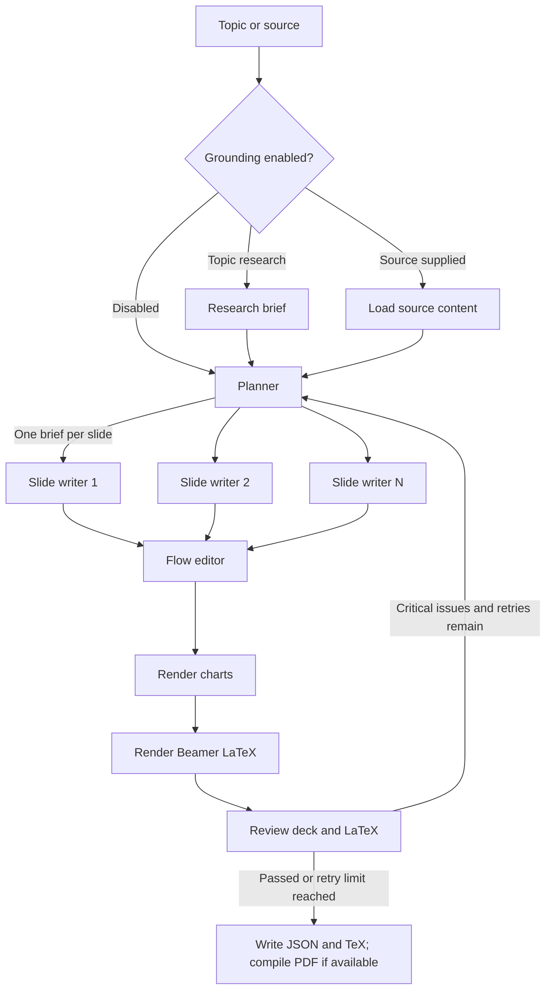

# Multi-agent Presentation Generator

Generate research-grounded Beamer presentations from a topic or source document. A team of specialized agents plans the deck, writes slides in parallel, edits the narrative, creates charts, and reviews the result. The project supports both an in-process LangGraph workflow and a distributed version that communicates over Google's Agent2Agent (A2A) protocol.

## Features

- Build presentations from a topic, PDF, text or Markdown file, local folder, or public GitHub repository.
- Research topics before drafting, with source grounding and a Wikipedia-only quick mode.
- Plan and write slides with LangChain and LangGraph, including parallel slide writing.
- Edit an existing deck using plain-language comments without regenerating every slide.
- Create deterministic charts and render structured slide content to LaTeX Beamer.
- Review generated decks and retry when critical issues are found.
- Optionally build a PDF when `tectonic` or `pdflatex` is installed.
- Trace agent and model activity with Opik when configured.

## Requirements

- Python 3.10 or newer
- An OpenAI API key (`OPENAI_API_KEY`) for standard use
- `tectonic` or `pdflatex` to compile the generated Beamer source to PDF (optional)

Install the Python dependencies:

```bash
python3 -m venv .venv
source .venv/bin/activate
python -m pip install -r requirements.txt
```

## Quick start

Create a presentation from a topic:

```bash
python main.py \
  --topic "Google Gemini" \
  --author "Your Name" \
  --institute "Your Organization" \
  --slides 6 \
  --out out/gemini
```

The title slide is added in addition to the requested number of content slides. The output folder contains `presentation.tex`, `deck.json`, `outline.json`, and `review.json`; it also contains `presentation.pdf` when a LaTeX compiler is available.

An example presentation is available at [`examples/a2a-agent-protocol-30-slides.pdf`](examples/a2a-agent-protocol-30-slides.pdf).

## Usage

### Build from a source

Supported sources include PDFs, `.txt` and `.md` files, local directories, and public GitHub repositories. When `--topic` is omitted, the source title is used.

```bash
python main.py --source ~/Documents/paper.pdf --slides 10 --out out/paper
python main.py --source https://github.com/owner/repository --slides 10 --out out/repository
```

Source-based decks are grounded in the supplied material. The source content is provided to the planning and writing agents with instructions to avoid introducing unsupported facts.

### Edit an existing deck

Pass comments directly or through a comments file. Comments can target a slide, change its content, or request a slide be added or removed.

```bash
python main.py \
  --edit out/gemini/deck.json \
  --outline out/gemini/outline.json \
  --comments $'Slide 5: shorten the bullets\nDrop slide 6, it repeats slide 3' \
  --out out/gemini-revised
```

Comments can also be applied while building a new deck:

```bash
python main.py --topic "Google Gemini" --slides 6 \
  --comments "overall: keep every bullet under 12 words" --out out/gemini
```

### Run with A2A agents

The A2A entry point starts the Planner, Writer, Editor, Chart, and Reviewer servers, runs the workflow, and then shuts the servers down.

```bash
python run_a2a.py --topic "Google Gemini" --slides 6 --out out/gemini-a2a
```

The agents publish Agent Cards and listen on ports 8101–8105 by default. See `src/presentation_generator/a2a_agents.py` for the port mapping.

### Research and search options

Deep research runs by default for topic-based decks. To use quick Wikipedia grounding or turn grounding off:

```bash
python main.py --topic "Quantum computing" --shallow --slides 8 --out out/quantum
python main.py --topic "Internal brainstorming" --no-search --slides 8 --out out/brainstorm
```

When a source is provided, its contents are used for grounding and the topic research phase is skipped. If reliable search material is unavailable, the run reports that limitation in its output.

### Useful options

| Option | Description |
| --- | --- |
| `--topic` | Presentation subject; optional when `--source` is provided |
| `--source` | PDF, text/Markdown file, local folder, or public GitHub repository |
| `--slides` | Number of content slides (default: 6; title slide is extra) |
| `--author`, `--institute` | Title slide attribution |
| `--model` | Override the default model (`gpt-4o-mini`) |
| `--out` | Output directory (default: `out`) |
| `--no-charts` | Disable chart generation |
| `--shallow` | Skip deep research and use quick Wikipedia grounding |
| `--no-search` | Disable topic grounding |
| `--comments`, `--comments-file` | Apply editing instructions |

Run `python main.py --help` or `python run_a2a.py --help` for the full command-line help.

### FastAPI server for a UI

Start the API from the project root:

```bash
python -m pip install -r requirements.txt
python serve.py
```

### Streamlit presentation studio

Start the API in one terminal, then start the Streamlit interface in another:

```bash
streamlit run streamlit_app.py
```

The UI uses `http://localhost:8000` by default. Set `PRESENTATION_API_URL`
to point it at a different API host. It supports topic generation, PDF/TXT/MD
source uploads, chat-based revisions with conversation context, and PDF preview
and download when the API host has `tectonic` or `pdflatex` installed. The
generator produces Beamer source and an optional PDF; it does not currently
produce a `.pptx` file.

The interactive API reference is at `http://localhost:8000/docs`. A UI can
submit a build with `POST /api/generations`, poll `GET /api/generations/{id}`,
then fetch the deck and artifact list from `GET /api/generations/{id}/result`.
Download files such as `deck.json`, `presentation.pdf`, or chart PNGs from
`GET /api/generations/{id}/artifacts/{path}`. Generation is asynchronous and
returns HTTP 202 with the job ID and status URL.

Example request:

```json
{
  "topic": "Google Gemini",
  "author": "Your Name",
  "institute": "Your Organization",
  "slides": 6,
  "charts": true,
  "search": true
}
```

To revise a completed deck, post to `POST /api/generations/{id}/edits`. The
body accepts `comments` and optional `source_text` (up to 12,000 characters),
or `source` for a local path or public GitHub repository. For example:

```json
{
  "comments": "Slide 3: update the market-size figures using the supplied source",
  "source_text": "Paste the source excerpt or extracted document text here."
}
```

The edit returns a new job ID and keeps the original generation unchanged. Poll
and fetch its result and artifacts through the same status, result, and artifact
routes. Comments can target slides, request additions or removals, or make
overall changes. Source material is provided to the editor with instructions to
apply it to the targeted slide(s).

Browser clients can upload a PDF, TXT, or Markdown file directly with
`multipart/form-data`: use `POST /api/generations/upload` with a `file` field
and optional generation fields, or `POST /api/generations/{id}/edits/upload`
with `file` and `comments` fields. Uploads are limited to 20 MB and extracted
source text is capped by the existing source loader.

The generated presentation format is Beamer LaTeX with an optional compiled
PDF; this server does not currently emit a PowerPoint `.pptx` file.

Set `PRESENTATION_CORS_ORIGINS` to a comma-separated list of UI origins when
the frontend runs on a different origin (defaults allow localhost ports 3000
and 5173). `PRESENTATION_OUTPUT_DIR` changes the artifact directory, and
`PRESENTATION_API_WORKERS` controls concurrent generation jobs. Jobs are held
in memory, so their status is lost when the server restarts; generated files
remain in the output directory.

### Run with Docker

Build and start the API, persisting generated files in the local `out` folder:

```bash
docker build -t presentation-generator .
docker run --rm -p 8000:8000 \
  -e OPENAI_API_KEY \
  -v "$(pwd)/out:/app/out" \
  presentation-generator
```

Open `http://localhost:8000/docs` to use the API. Set `OPENAI_MODEL`,
`PRESENTATION_CORS_ORIGINS`, or other supported environment variables with
additional `-e NAME=value` options. If your machine uses the Muse credential
helper instead of `OPENAI_API_KEY`, provide the key through the environment;
the helper itself is not included in the image.

## Configuration

The default model is `gpt-4o-mini`. Set `OPENAI_API_KEY` to use the OpenAI API, or set `OPENAI_MODEL` to choose a different default model. The application also supports the Muse secure OpenAI connector helper when available.

Optional Opik tracing is enabled when `OPIK_API_KEY` is set. Set `PRESENTATION_OPIK=off` to disable tracing. Without an Opik key, tracing is a no-op and does not affect deck generation.

## How it works



1. **Research** gathers topic information and prepares a research brief, unless grounding is disabled or a source is supplied.
2. **Planner** creates a structured outline with a brief for each slide.
3. **Writers** draft slides in parallel against their briefs.
4. **Flow editor** reviews the deck as a whole, improving transitions and removing repetition.
5. **Chart agent** prepares requested visuals.
6. **Renderer and reviewer** convert structured slide data into Beamer LaTeX, validate the output, and review the deck. Critical issues can trigger a fresh planning and writing attempt.
7. **Compiler** writes the output artifacts and builds a PDF when a supported LaTeX compiler is installed.

Slide content remains structured data until rendering. This keeps LaTeX escaping and document structure under deterministic control rather than asking a language model to produce raw LaTeX.

## Project structure

```text
main.py                             Main CLI
run_a2a.py                          A2A CLI and server lifecycle
src/presentation_generator/
  graph.py                          In-process LangGraph workflow
  graph_a2a.py                      LangGraph workflow using A2A clients
  a2a_agents.py                     Agent implementations and port mapping
  a2a_client.py                     A2A client helpers
  a2a_server.py                     A2A server entry point
  research.py                       Deep research workflow
  search_grounding.py               Search and Wikipedia grounding
  sources.py                        PDF, file, folder, and GitHub source loading
  models.py                         Pydantic data models
  latex_utils.py                    Beamer rendering and validation
  charts.py                         Chart generation
  comments.py                       Comment-based deck editing
  llm.py                            Model configuration and backends
  tracing.py                        Optional Opik tracing
```

## License

This project is licensed under the MIT License. See [LICENSE](LICENSE) for details.
